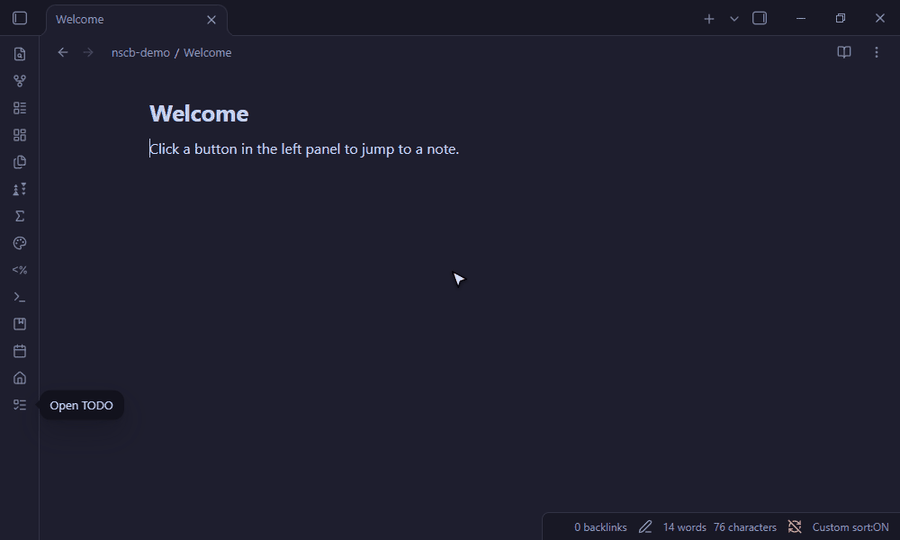

# Note Shortcut Button

An Obsidian plugin that adds buttons to the left panel (the ribbon) that open the notes you
choose, the way the home button opens your homepage. Each button has its own icon and,
optionally, its own keyboard shortcut.

> This plugin was vibecoded: all of its code and this README were written by AI
> ([Claude Code](https://claude.com/claude-code)), directed and tested by Omer Cooper.

## Using it

Open **Settings → Note Shortcut Button**. Each row is one button:

| Control | What it does |
|---|---|
| **+** | Adds a shortcut |
| Note box | The note to open. Suggests notes as you type; `Note`, `folder/Note` and `[[Note]]` all work, and canvases too |
| **Choose icon** | Pick the button's icon from a searchable list of all icons |
| Shortcut box | Click it, then press a key combination such as `Ctrl+Shift+T`. **Esc** cancels, **Backspace** removes it |
| **No shortcut** | Shown once a shortcut is set: sets it back to no shortcut |
| **×** / drag handle | Delete the row / drag to reorder (Obsidian before 1.13: ↑ and 🗑) |

Changes show up in the left panel right away. Clicking a button opens its note, or switches to
its tab if the note is already open.

On first install, if your vault has a note named "TODO", a shortcut to it is added for you.

## Good to know

- **Renaming and moving:** when you rename or move a note (or its folder) inside Obsidian, its
  shortcut follows it. Renames made outside Obsidian, such as in your file manager, are not
  seen; fix the link in the settings.
- **Keyboard shortcuts win over Obsidian's own hotkeys.** If you pick a combination Obsidian
  already uses, the note opens instead. Combinations with Ctrl+Shift or Ctrl+Alt rarely clash.
  Two shortcuts can't share a combination: setting it on one removes it from the other.
- **Note suggestions** read the list of file paths in your vault, only while you type in a
  shortcut's note box, to show matching notes. Nothing is read from inside the notes and nothing
  leaves your computer.
- **Buttons** are removed through an internal Obsidian method (`removeRibbonAction`, the one
  Obsidian uses when a plugin is turned off), because the public API has no way to remove a
  single ribbon button.

## Install

**From Obsidian:** Settings → Community plugins → Browse → search for "Note Shortcut Button"
(once it is listed).

**With BRAT:** install [BRAT](https://github.com/TfTHacker/obsidian42-brat), run
**BRAT: Add a beta plugin for testing** and enter `OmerCooper/note-shortcut-button`.

**Manually:** copy `main.js`, `manifest.json` and `styles.css` from the
[latest release](https://github.com/OmerCooper/note-shortcut-button/releases/latest) into
`<vault>/.obsidian/plugins/note-shortcut-button/`, reload Obsidian and turn the plugin on under
Settings → Community plugins.

## License

[MIT](LICENSE)
